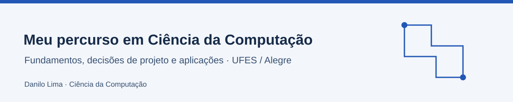

# Meu percurso em Ciência da Computação

Sou Danilo Lima. Reúno aqui fundamentos, trabalhos e decisões técnicas do meu percurso em Ciência da Computação na **Universidade Federal do Espírito Santo, em Alegre**. A central conecta a grade do curso ao que pode ser explorado em código, protótipos e documentação.

[English](README.en.md) · [Grade completa](grade.md) · [Projetos](#projetos) · [Meu GitHub](https://github.com/Danilo-Js)

## Comece pelos projetos

**Componentes que viram aplicativo.** No eixo do TCC, a [biblioteca React Native](projetos/react-native-ecommerce-components.md) define os componentes e o [TechEcommerce](projetos/TechEcommerce.md) demonstra seu uso em um fluxo com dados simulados.

**Uma linguagem vista por dentro.** O [Brazukol Compiler](projetos/Brazukol-Compiler.md) conecta tokens, estrutura do programa e verificações semânticas em uma IDE didática.

**Uma interface que organiza trabalho.** O [Kanb-Ex](projetos/Kanb-Ex.md) reúne componentes Vue, gerenciamento de estado e persistência local em um quadro de tarefas.

<table><tr><td width="50%" valign="top"> <strong>Brazukol Compiler</strong> Análise léxica, sintática e semântica.</td><td width="50%" valign="top"> <strong>Kanb-Ex</strong> Componentes, estado e persistência no navegador.</td></tr></table>

## Explore por área

| Área | Pergunta que orienta a leitura |
|---|---|
| [Software e interfaces](areas/software.md) | Como transformar uma necessidade em contratos, componentes e uma interação clara? |
| [Linguagens e compiladores](areas/linguagens.md) | Como um programa é reconhecido e verificado? |
| [IA e linguagem natural](areas/ia.md) | Como representar conhecimento, interpretar dados e selecionar ações? |
| [Sistemas e redes](areas/sistemas.md) | Como componentes se comunicam e como conferir integridade? |
| [Dados e análise](areas/dados.md) | Como preparar dados e interpretar uma visualização sem exagerar suas conclusões? |

## Da grade à prática

A [grade navegável](grade.md) leva a páginas com conceitos, exemplos e conexões. É possível seguir a sequência sugerida do curso ou partir de um projeto e voltar aos fundamentos.

| Períodos sugeridos | Foco |
|---|---|
| 1–2 | Programação, lógica, matemática e estruturas de dados |
| 3–4 | Arquitetura, linguagens formais, bancos de dados e sistemas |
| 5–6 | Requisitos, algoritmos, redes, interfaces e projeto de software |
| 7–8 | Compiladores, IA, gestão, estágio e TCC |

## Projetos

| Projeto | Contexto | Tecnologias / temas | Material |
|---|---|---|---|
| [Componentes para e-commerce](projetos/react-native-ecommerce-components.md) | TCC · Ciência da Computação · UFES | React Native · TypeScript · React | Código e documentação públicos |
| [TechEcommerce](projetos/TechEcommerce.md) | Aplicação demonstrativa do TCC · UFES | React Native 0.78 · React 19 · TypeScript · Context API | Código e documentação públicos |
| [Brazukol Compiler](projetos/Brazukol-Compiler.md) | Compiladores · Ciência da Computação · UFES | Java 8 · Swing · JFlex · Maven | Código e documentação públicos |
| [Kanb-Ex](projetos/Kanb-Ex.md) | Tópicos Especiais em Programação II · UFES · 2023/2 | Vue 3 · Vuex 4 · Vue Router 4 · LocalForage | Código e documentação públicos |
| [Batalha de tanques em Prolog](projetos/AI-Tank-Battle.md) | Inteligência Artificial · UFES · 2023/2 | SWI-Prolog · JavaScript · HTML · CSS | Código e documentação públicos |
| [Prolog Car Race](projetos/prolog-car-race.md) | Inteligência Artificial · Ciência da Computação · UFES | SWI-Prolog · JavaScript · HTML · CSS | Código e documentação públicos |
| [Exercícios de linguagem natural](projetos/NPL-Exercises.md) | Tópicos Especiais em Informática II · PLN · UFES | Python · Corpus textual · Transdutores · N-gramas | Código e documentação públicos |
| [Assinaturas de arquivos](projetos/File-Signature-Generator.md) | Tópicos Especiais em Redes de Computadores I · Computação Forense · UFES | Python · hashlib · Sistema de arquivos | Código e documentação públicos |
| [Biblioteca Virtual](projetos/Biblioteca-Virtual.md) | Engenharia de Requisitos de Software · UFES | Requisitos · Modelagem · Prototipação · Documentação | Código e documentação públicos |
| [Chat com Mediator](projetos/Mediator_Chat.md) | Projeto de Sistemas de Software · UFES | Java 8 · Maven · Mediator | Resumo técnico · acervo privado |
| [Gráficos com Builder](projetos/atividade_grafico.md) | Projeto de Sistemas de Software · UFES | Java 8 · Swing · JFreeChart · Builder | Resumo técnico · acervo privado |
| [Regras de delivery](projetos/atividade_delivery.md) | Projeto de Sistemas de Software · UFES | Java 8 · Maven · Interfaces · Regras de cálculo | Resumo técnico · acervo privado |
| [Gerenciador de compras](projetos/Gerenciador_compras.md) | COM10615 · Tópicos Especiais em Programação I · UFES/Alegre | HTML · CSS · JavaScript · Node.js · Express · SQLite | Resumo técnico · acervo privado |
| [Estação climática com Observer](projetos/EstacaoClimatica.md) | Estudo de padrões de projeto · acervo de computação | Java 8 · Swing · Observer · JFreeChart | Resumo técnico · acervo privado |
| [Acesso e gestão de usuários](projetos/acesso_usuarios.md) | Estudo de arquitetura e padrões · acervo de computação | Java 8 · Swing · SQLite · MVP · Padrões de projeto | Código e documentação públicos |
| [Gráficos de dados do npm](projetos/npm-library-graph-generator.md) | Ferramenta de estudo e apoio à análise de bibliotecas | Python · requests · Matplotlib · API npm | Código e documentação públicos |

## O que conecta os trabalhos

- **Abstração e contratos:** de estruturas de dados às propriedades de um componente reutilizável.
- **Decisões verificáveis:** requisitos e critérios ajudam a explicar por que uma solução foi escolhida.
- **Separação de responsabilidades:** padrões e camadas organizam mudanças e colaboração.
- **Leitura crítica de resultados:** demonstração, teste, métrica de uso e resultado comercial respondem a perguntas diferentes.

## Estudos complementares

Além do material acadêmico, mantenho exercícios de [React Native](https://github.com/Danilo-Js/React-Native-My-First-Projects), [Vue](https://github.com/Danilo-Js/VueJS-2-My-First-Projects) e o [Repo Searcher](https://github.com/Danilo-Js/Repo-Searcher). Eles conservam o contexto de estudo e as referências de seus próprios READMEs.

## Autoria e contexto

Os trabalhos em grupo preservam seus créditos. Bases de terceiros, como as das simulações de carros e tanques, são identificadas nos respectivos casos. Repositórios privados continuam com acesso restrito; seus resumos públicos não reproduzem bases de dados, credenciais ou documentos de terceiros.

A grade histórica é uma referência de organização, não um histórico escolar. As sínteses conceituais não atribuem notas, datas de conclusão ou certificações. Os projetos ligados mantêm suas próprias licenças e limitações. [Sobre a organização e as fontes](sobre.md).
